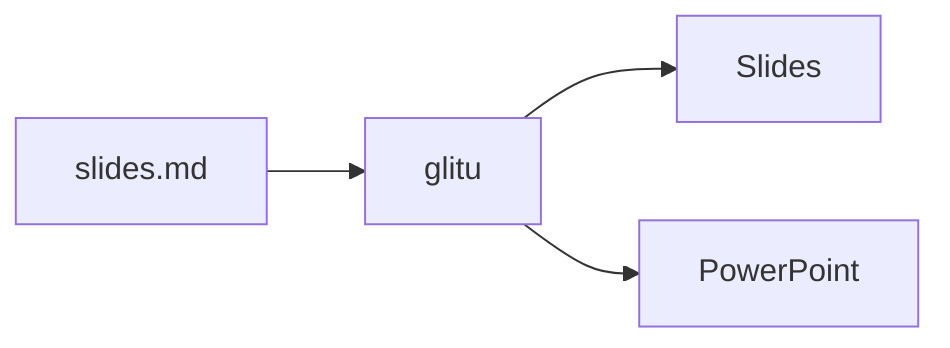
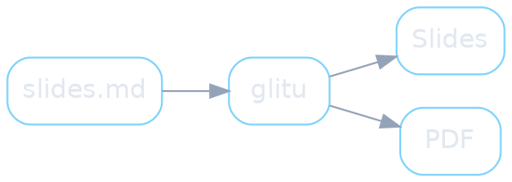

# Architecture

The crates, and the diagram tools of your machine

## The open-source pieces {.large}

- The markdown goes through glitu; the engine runs it in the browser

```skemo
diagram(dir="right")
  card#deck.project(icon="folder-open") Your presentation
    | slides.md, chapters
    | terminals, images
    to(cli)

  zone#glitu Repository glitu                                       @1
    card#cli.crate(icon="terminal") glitu                           @1
      | build · server
      to(core)
      to(engine) runs                                               @2
      to(files).dashed exports                                      @4
    card#core.crate(icon="cpu") glitu-core                          @2
      | markdown → HTML slides
      | code, formulas
    card#web.wasm(icon="monitor") glitu-web                         @3
      | navigation, steps
      | speaker view, themes
      to(site page).dashed runs                                     @4

  card#engine.crate(icon="share-2") skemo, d2, dot, mermaid         @2
    | command lines you install
    | diagrams, rendered at build

  zone#outputs.output What you get                                  @4
    card#site.output(icon="globe") Static site
    card#page.output(icon="file-down") Standalone page
    card#files.output(icon="presentation") PPTX · PDF · PNG

  card#static.static(icon="cloud") glitu.net/static                 @5
    | engine and themes
    | one version per folder
    to(web).dashed hosts                                            @5
```

Note: Your presentation is plain files. [click] The glitu tool reads them. [click] Its compiler,
glitu-core, turns them into slides; the diagrams are drawn by the tools of your machine, skemo
first, run confined. [click] glitu-web,
compiled to WebAssembly, presents them. [click] What you get. [click] And glitu.net/static hosts
each version of the engine and of the themes.

## Mermaid

- Flowcharts, sequences, states, Gantt
- Drawn by mermaid.js in a browser glitu drives, or by `mmdc`
- A diagram appears as a whole, at its click @1



Note: Any diagram language glitu knows takes the place of the visual. [click] A Mermaid flowchart,
appearing at its click.

## D2

- Declarative diagrams, by Terrastruct
- `d2.theme=200` and the other declared options on the fence

```d2 d2.theme=200 d2.pad=20
md: slides.md
glitu: glitu
page: Slides
md -> glitu: build
glitu -> page: renders
```

Note: D2, rendered by the `d2` command line of the machine.

## Graphviz

- The `dot` command line
- Graphs laid out automatically



Note: Graphviz, the oldest of them: `dot` lays the graph out.
